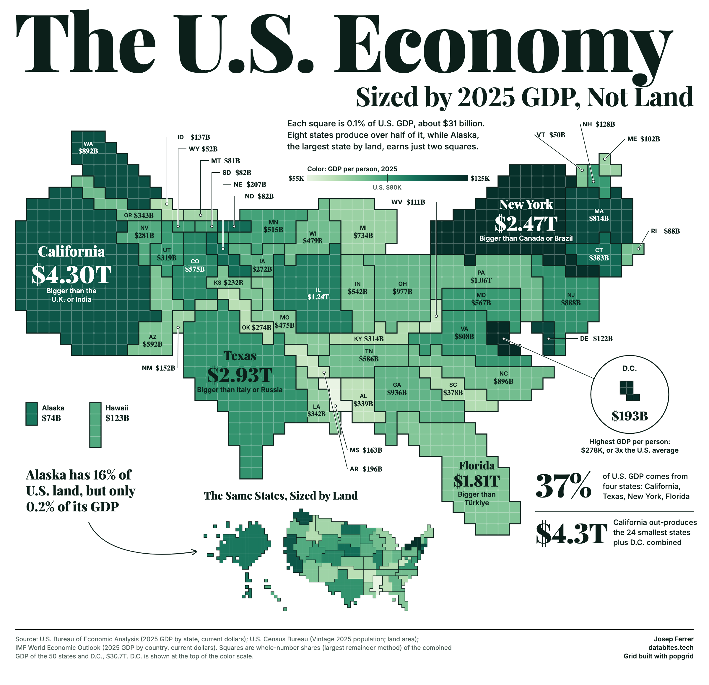
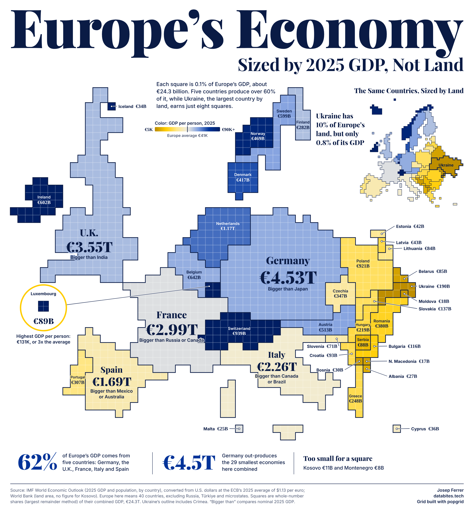
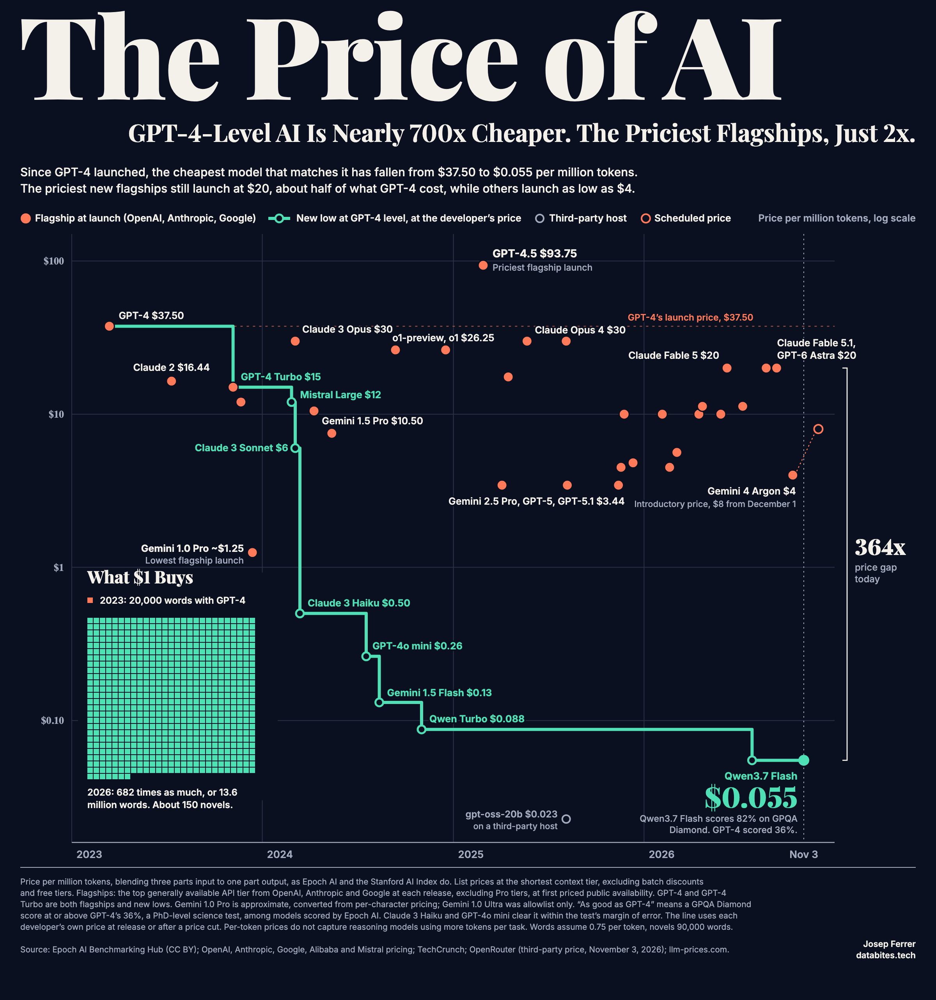

# Dataviz

Charts and maps with the code and data behind them, by [Josep Ferrer](https://databites.tech/gh). Each folder is one piece with its own code, data snapshot and dependencies, so you can rerun it or adapt it to your own data.

Looking for the interactive projects (scrollytelling, explorers, atlases)? They're indexed in **[data-storytelling](https://github.com/iamjosepferrer/data-storytelling)**.

## Gallery

| | |
|---|---|
|  | **[The U.S. Economy, Sized by 2025 GDP, Not Land](us-economy-by-gdp)** A popgrid map with one square for each 0.1% of U.S. GDP. |
|  | **[Europe's Economy, Sized by 2025 GDP, Not Land](europe-economy-by-gdp)** The same map for 40 European countries, in EU blue and gold. |
|  | **[The Price of AI](price-of-ai)** GPT-4-level AI is nearly 700x cheaper, while the priciest flagships are only about 2x cheaper. |

## #30DayMapChallenge

My daily maps of Europe for the 2026 challenge, one clear finding per map. Code, data and methods live in [their own repo](https://github.com/iamjosepferrer/30daymapchallenge).

- [Day 1, Points](https://github.com/iamjosepferrer/30daymapchallenge/blob/main/2026/README.md#day-1-points): half of Europe's city dwellers live in just 80 urban areas
- [Day 2, Lines](https://github.com/iamjosepferrer/30daymapchallenge/blob/main/2026/README.md#day-2-lines): Europe's biggest port is the nearest one for under 4% of city dwellers
- [Day 3, Polygons](https://github.com/iamjosepferrer/30daymapchallenge/blob/main/2026/README.md#day-3-polygons): half of Europe's tourist nights happen in just 102 of its 1,247 regions
- [Day 4, Clusters](https://github.com/iamjosepferrer/30daymapchallenge/blob/main/2026/README.md#day-4-clusters): a third of the land in the EU, Norway and Switzerland is just three empty patches
- [Day 5, Senses, Sight](https://github.com/iamjosepferrer/30daymapchallenge/blob/main/2026/README.md#day-5-senses-sight): Spain gets two total eclipses in a row, but Madrid and Barcelona miss both
- [Day 6, Vintage](https://github.com/iamjosepferrer/30daymapchallenge/blob/main/2026/README.md#day-6-vintage): half of Europe's people live on land Rome once ruled
- [Day 7, 10 minute map](https://github.com/iamjosepferrer/30daymapchallenge/blob/main/2026/README.md#day-7-10-minute-map): the EU's farthest point from the sea is 660 km inland, in Slovakia
- [Day 8, Utopia](https://github.com/iamjosepferrer/30daymapchallenge/blob/main/2026/README.md#day-8-utopia): only 3% of people in the EU already breathe the air of a cleaner future
- [Day 9, Urban-rural](https://github.com/iamjosepferrer/30daymapchallenge/blob/main/2026/README.md#day-9-urban-rural): most of the EU is set to have fewer people in 2050 than it has today
- [Day 10, Prompting only](https://github.com/iamjosepferrer/30daymapchallenge/blob/main/2026/README.md#day-10-prompting-only): 5 AIs drew Europe from memory. ChatGPT and Claude: 91%. Grok: 56%.
- [Day 11, Senses, Sound](https://github.com/iamjosepferrer/30daymapchallenge/blob/main/2026/README.md#day-11-senses-sound): almost half of people in EU cities live with road noise louder than WHO advises
- [Day 12, Power](https://github.com/iamjosepferrer/30daymapchallenge/blob/main/2026/README.md#day-12-power): the Netherlands has the most solar panels per person in the EU
- [Day 13, Interactions](https://github.com/iamjosepferrer/30daymapchallenge/blob/main/2026/README.md#day-13-interactions): the 10 biggest Erasmus flows run between four countries

## Want one built on your data?

I make maps, charts and data stories for public bodies, research groups and companies. **[Tell me what you need](https://databites.tech/gh)** and I reply within 2 business days.

## License

Code is under the [MIT License](LICENSE). Graphics are under [CC BY 4.0](https://creativecommons.org/licenses/by/4.0/): share them freely with credit to Josep Ferrer.
