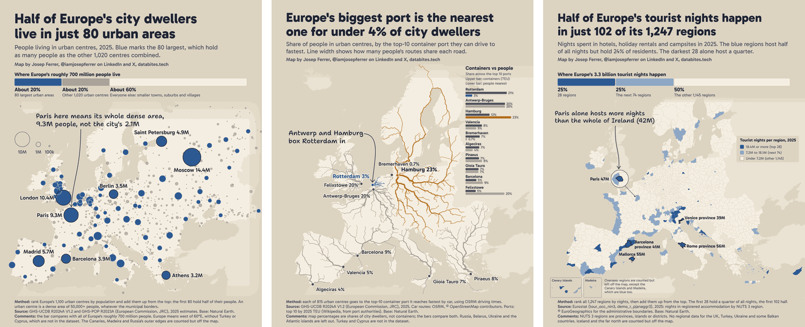

# Dataviz

Data visualizations and the code behind them, by [Josep Ferrer](https://databites.tech). Each folder is one piece with its own code, data snapshot and dependencies.

## Gallery

| | |
|---|---|
|  | **[The U.S. Economy, Sized by 2025 GDP, Not Land](us-economy-by-gdp)** A popgrid map with one square for each 0.1% of U.S. GDP. |
|  | **[Europe's Economy, Sized by 2025 GDP, Not Land](europe-economy-by-gdp)** The same map for 40 European countries, in EU blue and gold. |
|  | **[The Price of AI](price-of-ai)** GPT-4-level AI is nearly 700x cheaper, while the frontier is only about 2x cheaper. |

## #30DayMapChallenge

My daily maps of Europe for the 2026 challenge live in [their own repo](https://github.com/iamjosepferrer/30daymapchallenge).

- [Day 1, Points](https://github.com/iamjosepferrer/30daymapchallenge/blob/main/2026/README.md#day-1-points): half of Europe's city dwellers live in just 80 urban areas
- [Day 2, Lines](https://github.com/iamjosepferrer/30daymapchallenge/blob/main/2026/README.md#day-2-lines): Europe's biggest port is the nearest one for under 4% of city dwellers
- [Day 3, Polygons](https://github.com/iamjosepferrer/30daymapchallenge/blob/main/2026/README.md#day-3-polygons): half of Europe's tourist nights happen in just 102 of its 1,247 regions

## License

Code is under the [MIT License](LICENSE). Graphics are under [CC BY 4.0](https://creativecommons.org/licenses/by/4.0/): share them freely with credit to Josep Ferrer.
