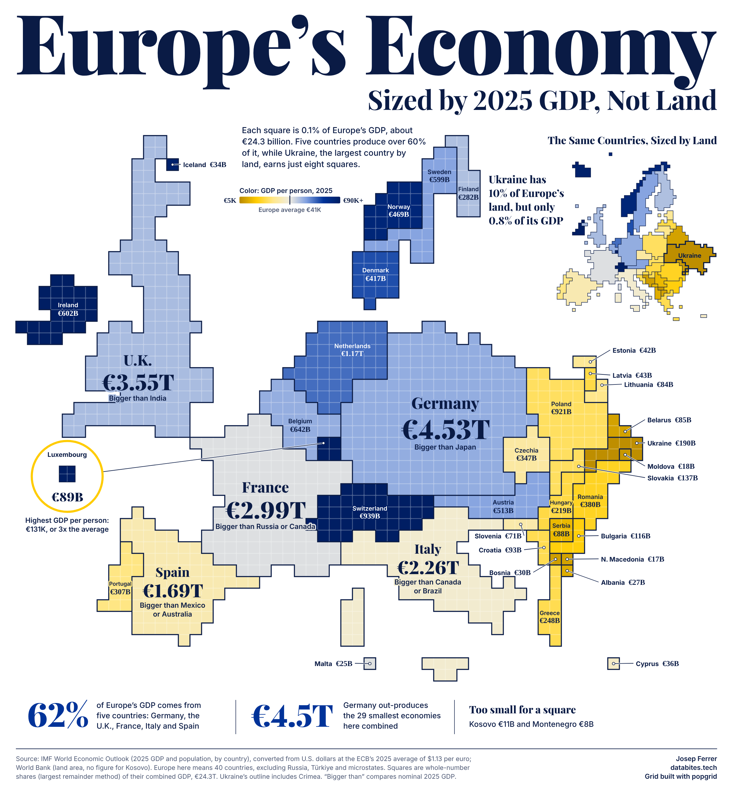

# Europe's Economy, Sized by 2025 GDP, Not Land



A tiled map of 40 European countries with 1,000 squares, each one 0.1% of their combined GDP (about €24.3 billion). Square count shows GDP. Color shows GDP per person, gold below the European average and blue above it. A small land map of the same countries sits alongside for contrast.

The squares come from [popgrid](https://github.com/databites-tech/popgrid).

## Scope

- Russia, Türkiye and microstates are left out.
- Kosovo and Montenegro are too small to earn a square, so the graphic lists them separately.
- Natural Earth files Crimea and Sevastopol under Russia. The script moves them to Ukraine.
- popgrid 0.7.1 gave Bosnia no square and North Macedonia one too many, so the script moves that square.

## Run it

Needs Python and an installed Chrome, Chromium or Edge, which renders the PNG.

```bash
pip install -r requirements.txt
python make_map.py            # rebuilds output.png from the snapshot
python make_map.py --refresh  # downloads current figures first
```

The script checks the claims on the graphic against the data and stops if one no longer holds. Revised figures can trigger this after `--refresh`.

## Sources

- [IMF World Economic Outlook](https://www.imf.org/en/publications/weo): 2025 GDP and population by country, current dollars
- [European Central Bank](https://data.ecb.europa.eu/data/datasets/EXR/EXR.A.USD.EUR.SP00.A): 2025 average exchange rate, $1.13 per euro, used to convert every amount to euros
- [World Bank](https://data.worldbank.org/indicator/AG.LND.TOTL.K2): land area, 2021 (no figure for Kosovo)
- [Natural Earth](https://www.naturalearthdata.com/): boundaries

Snapshots of the figures are in `data.csv` and `imf_2025.csv`.
