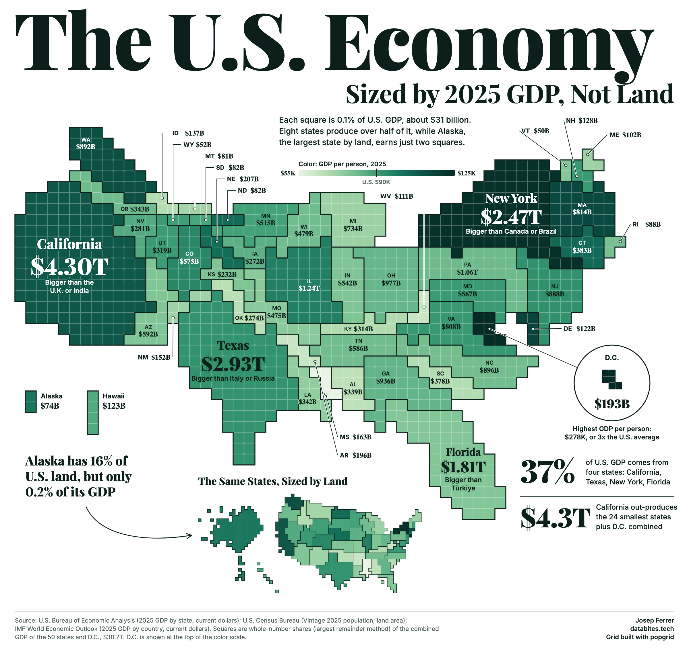
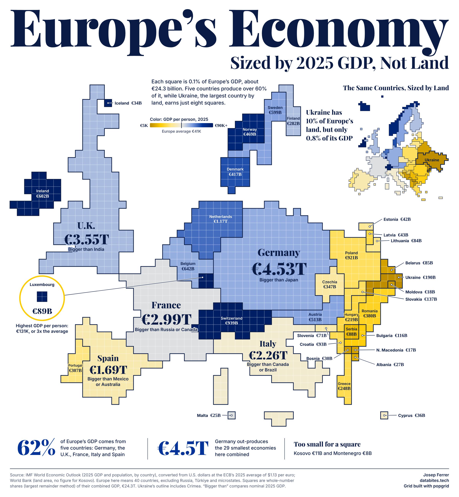
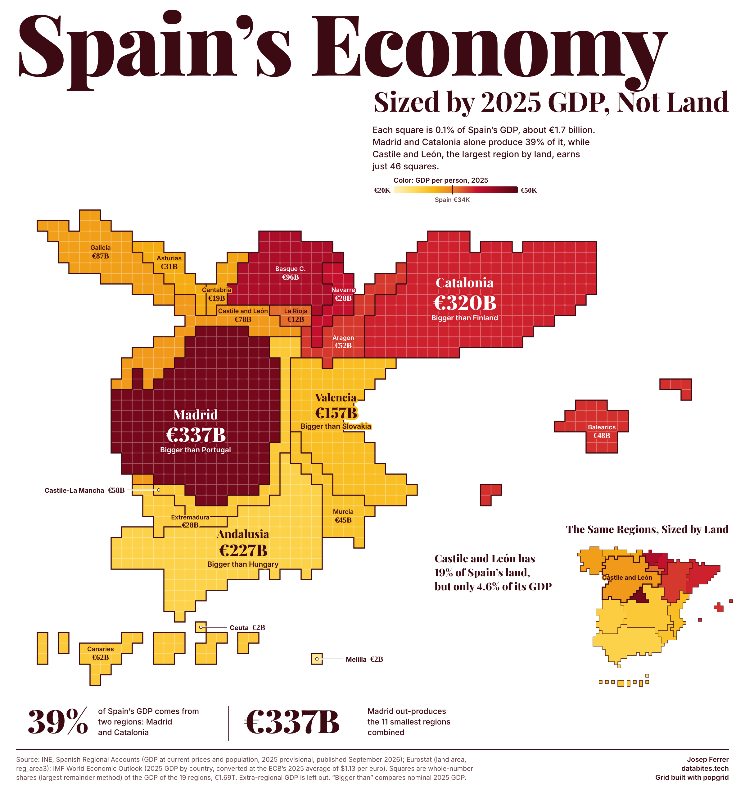
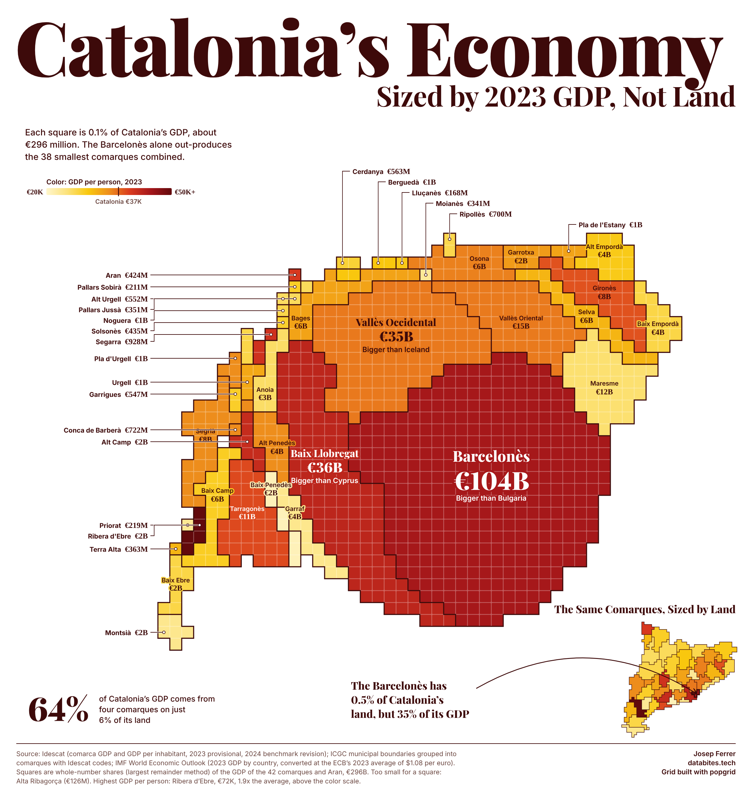
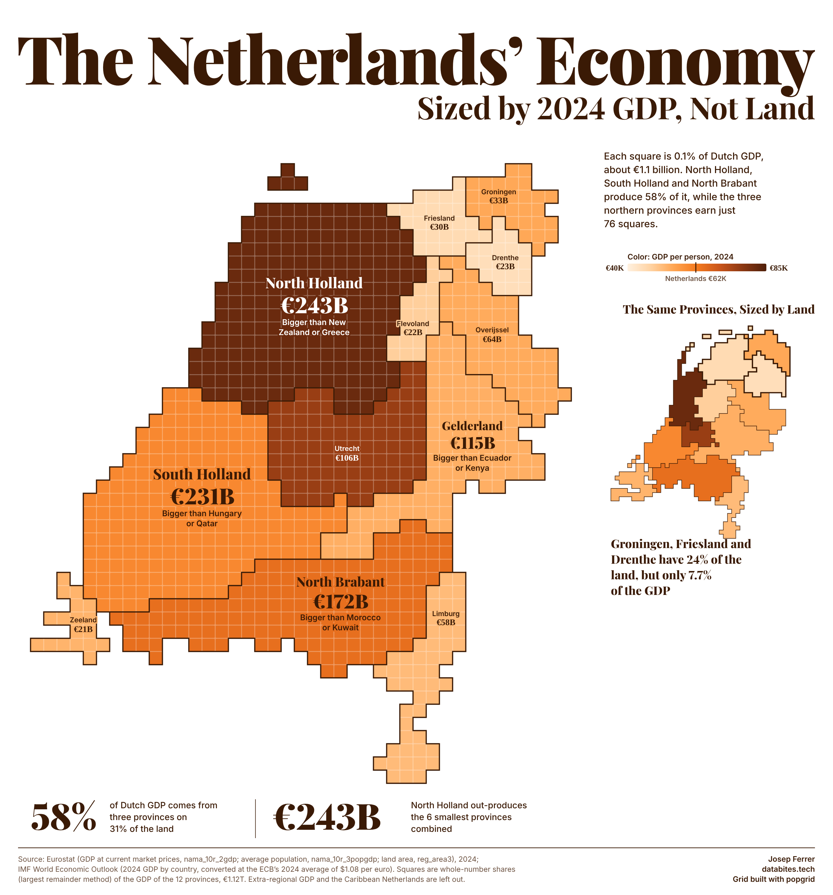
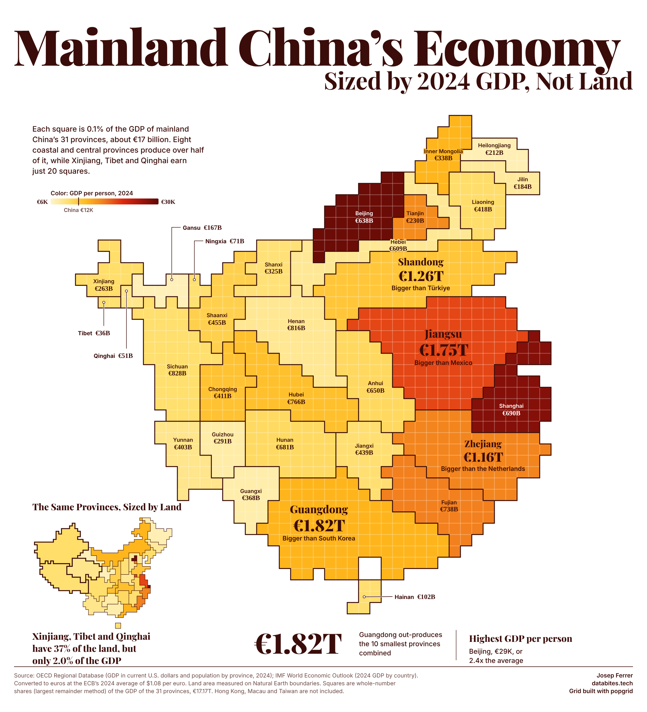

# Not by land, by GDP

Tiled maps that size each region by its GDP instead of its land, built with [popgrid](https://github.com/databites-tech/popgrid). Every square is 0.1% of the area's GDP, color shows GDP per person, and a small land map sits alongside for contrast.

| | |
|---|---|
| [](usa) | **[The U.S. Economy](usa)**<br>50 states and D.C., 2025, in dollars. |
| [](europe) | **[Europe's Economy](europe)**<br>40 European countries, 2025. |
| [](spain) | **[Spain's Economy](spain)**<br>17 autonomous communities, Ceuta and Melilla, 2025. |
| [](catalonia) | **[Catalonia's Economy](catalonia)**<br>42 comarques and Aran, 2023. |
| [](netherlands) | **[The Netherlands' Economy](netherlands)**<br>12 provinces, 2024. |
| [](china) | **[Mainland China's Economy](china)**<br>31 provinces, 2024. |

## How it is built

- `common.py` holds everything the posters share: downloads, fonts, the popgrid grid, colour, SVG drawing, the magnifier, the land inset, the PNG export, and `GridPoster`, the page builder used by every poster after the first two.
- Each folder has its own `make_map.py` with what is really its own: where the data comes from, the claims it checks, and where the labels go.
- Custom values go into popgrid through its public `PopGrid.from_geodataframe(weight_col=...)`; popgrid stays pinned at 0.7.1.
- Every number on a poster is computed from the data, and `check_claims()` stops the build if a sentence stops being true.

To add a country, copy the folder closest to it: `netherlands` for a European country on Eurostat data, `china` for any country on OECD regional data, `catalonia` for custom boundaries. Then set its regions, story and label positions.

## Run any of them

```bash
pip install -r requirements.txt
cd spain && python make_map.py
```
