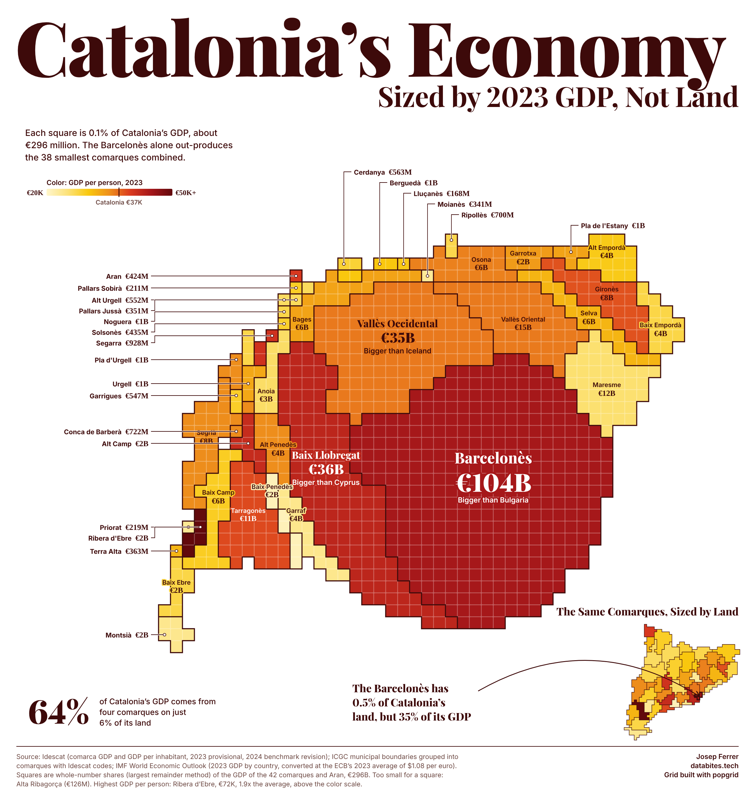

# Catalonia's Economy, Sized by 2023 GDP, Not Land



A tiled map of Catalonia's 42 comarques and Aran, with 1,000 squares, each one 0.1% of their combined GDP (about €296 million). Square count shows GDP, color shows GDP per person. A small land map of the same comarques sits alongside for contrast. Amounts are in euros.

The squares come from [popgrid](https://github.com/databites-tech/popgrid). Shared drawing code lives in [`../common.py`](../common.py).

## Scope

- 2023 is the latest year Idescat publishes by comarca (provisional figures).
- Comarca boundaries are built from municipal boundaries grouped with Idescat's current municipality codes, so El Lluçanès (created in 2023) is included.
- Alta Ribagorça is too small to earn a square, so the footer lists it.
- popgrid 0.7.1 drew three squares too many (Garrigues and Segarra), so the script removes them.

## Run it

Needs Python and an installed Chrome, Chromium or Edge, which renders the PNG.

```bash
pip install -r requirements.txt
python make_map.py            # rebuilds catalonia-economy-by-gdp.png from the snapshot
python make_map.py --refresh  # downloads current figures first
```

The script checks every claim on the graphic against the data and stops if one no longer holds. Revised figures can trigger this after `--refresh`.

## Sources

- [Idescat](https://www.idescat.cat/pub/?id=pibc): comarca GDP and GDP per inhabitant, 2023 provisional, 2024 benchmark revision; municipality and comarca codes
- [ICGC](https://www.icgc.cat/) municipal boundaries, via [gmarull/cat-topojson](https://github.com/gmarull/cat-topojson) and [sirisacademic/catalonia-cartography](https://github.com/sirisacademic/catalonia-cartography)
- [IMF World Economic Outlook](https://www.imf.org/en/publications/weo): 2023 GDP by country, for the comparisons
- [ECB](https://data.ecb.europa.eu/): 2023 average euro reference rate

Snapshots of the figures are in `data.csv` and the `imf_*.csv` file.
