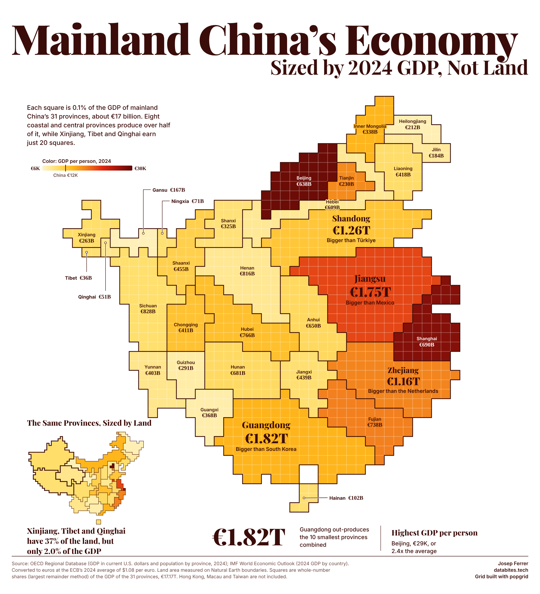

# Mainland China's Economy, Sized by 2024 GDP, Not Land



A tiled map of the 31 provinces of mainland China, with 1,000 squares, each one 0.1% of their combined GDP (about €17 billion). Square count shows GDP, color shows GDP per person. A small land map of the same provinces sits alongside for contrast. Amounts are in euros.

The squares come from [popgrid](https://github.com/databites-tech/popgrid). Shared drawing code lives in [`../common.py`](../common.py).

## Scope

- Hong Kong, Macau and Taiwan are not in the OECD regional data, so they are not included.
- Land shares are measured on Natural Earth boundaries.

## Run it

Needs Python and an installed Chrome, Chromium or Edge, which renders the PNG.

```bash
pip install -r requirements.txt
python make_map.py            # rebuilds china-economy-by-gdp.png from the snapshot
python make_map.py --refresh  # downloads current figures first
```

The script checks every claim on the graphic against the data and stops if one no longer holds. Revised figures can trigger this after `--refresh`.

## Sources

- [OECD Regional Database](https://data-explorer.oecd.org/): GDP in current U.S. dollars and population by province (TL2), 2024
- [IMF World Economic Outlook](https://www.imf.org/en/publications/weo): 2024 GDP by country, for the comparisons
- [ECB](https://data.ecb.europa.eu/): 2024 average euro reference rate
- [Natural Earth](https://www.naturalearthdata.com/): province boundaries, through popgrid

Snapshots of the figures are in `data.csv` and the `imf_*.csv` file.
