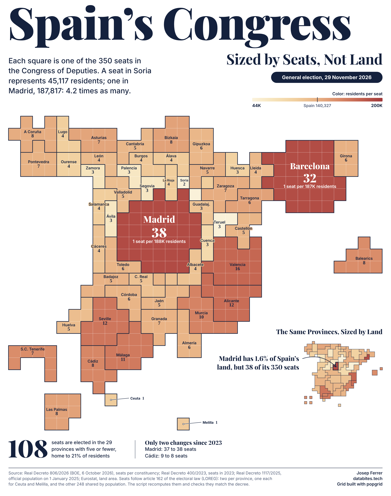

# Spain's Congress, Sized by Seats, Not Land



Versión en español: [El Congreso, por escaños, no por superficie](spain-seats-2026-es.png)

A tiled map of the 52 constituencies of Spain's Congress of Deputies for the general election of 29 November 2026, with 350 squares, one per seat. Color shows how many residents each seat represents: pale cream means fewer than the national average of 140,327, brick red means more. A small map in the corner sizes the same provinces by land.

A seat in Soria represents 45,117 residents, one in Madrid 187,817: 4.2 times as many.

The squares come from [popgrid](https://github.com/databites-tech/popgrid). Shared drawing code lives in [`../common.py`](../common.py).

## How seats are shared

Article 162 of the electoral law (LOREG) fixes the Congress at 350 seats: two per province, one each for Ceuta and Melilla, and the other 248 shared among the 50 provinces by population, with the largest remainders. The script recomputes the allocation from the official population of 1 January 2025 and stops if it differs from the decree.

Compared with the 2023 election, Madrid gains a seat (37 to 38) and Cádiz loses one (9 to 8).

## Scope

- The color counts residents, children and foreign residents included, so it is not a count of voters.
- The Canary Islands are moved next to the peninsula, with their islands side by side.

## Run it

Needs Python and an installed Chrome, Chromium or Edge, which renders the PNG.

```bash
pip install -r requirements.txt
python make_map.py            # rebuilds spain-seats-2026.png from the snapshot
python make_map.py --refresh  # re-reads the decrees from the BOE first
python make_map.py --lang es  # Spanish version, spain-seats-2026-es.png
```

The script checks every claim on the graphic against the data and stops if one no longer holds.

## Sources

- [Real Decreto 806/2026](https://www.boe.es/boe/dias/2026/10/06/pdfs/BOE-A-2026-20742.pdf) (BOE, 6 October 2026): seats per constituency for the 29 November 2026 election
- [Real Decreto 400/2023](https://www.boe.es/eli/es/rd/2023/05/29/400): seats per constituency in 2023
- [Real Decreto 1117/2025](https://boe.es/boe/dias/2025/12/11/pdfs/BOE-A-2025-25362.pdf): official population by province on 1 January 2025
- [Eurostat](https://ec.europa.eu/eurostat/databrowser/view/reg_area3/default/table): land area (reg_area3)

A snapshot of the figures is in `data.csv`.
