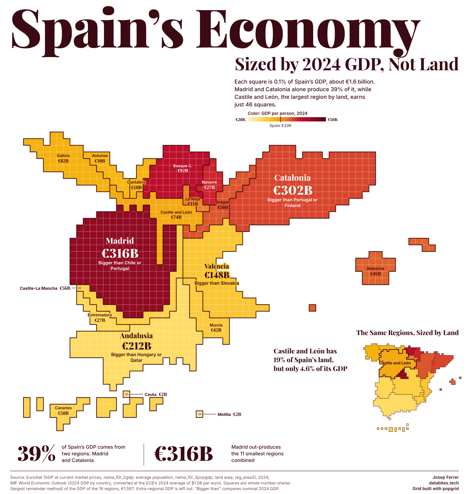

# Spain's Economy, Sized by 2024 GDP, Not Land



A tiled map of Spain's 17 autonomous communities and the cities of Ceuta and Melilla, with 1,000 squares, each one 0.1% of their combined GDP (about €1.6 billion). Square count shows GDP, color shows GDP per person. A small land map of the same regions sits alongside for contrast. Amounts are in euros.

The squares come from [popgrid](https://github.com/databites-tech/popgrid). Shared drawing code lives in [`../common.py`](../common.py).

## Scope

- Extra-regional GDP (Eurostat's ESZZ) is left out.
- The Canary Islands are moved next to the peninsula, with their islands side by side.

## Run it

Needs Python and an installed Chrome, Chromium or Edge, which renders the PNG.

```bash
pip install -r requirements.txt
python make_map.py            # rebuilds spain-economy-by-gdp.png from the snapshot
python make_map.py --refresh  # downloads current figures first
```

The script checks every claim on the graphic against the data and stops if one no longer holds. Revised figures can trigger this after `--refresh`.

## Sources

- [Eurostat](https://ec.europa.eu/eurostat/databrowser/view/nama_10r_2gdp/default/table): GDP at current market prices by NUTS 2 region (nama_10r_2gdp), average population (nama_10r_3popgdp) and land area (reg_area3), 2024
- [IMF World Economic Outlook](https://www.imf.org/en/publications/weo): 2024 GDP by country, for the comparisons
- [ECB](https://data.ecb.europa.eu/): 2024 average euro reference rate

Snapshots of the figures are in `data.csv` and the `imf_*.csv` file.
