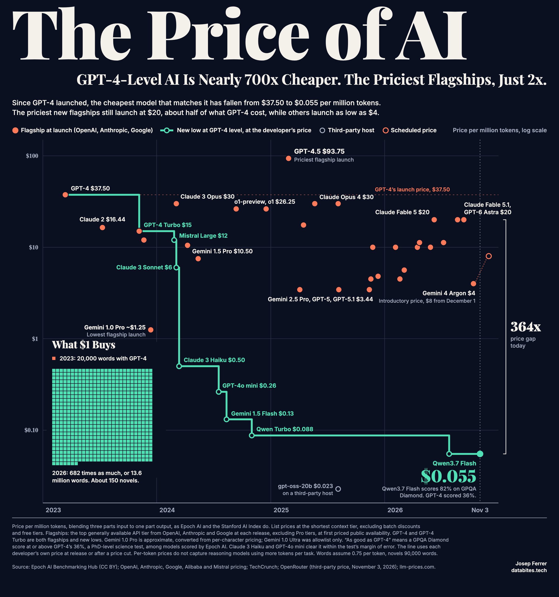

# The Price of AI



The cheapest model at least as good as GPT-4 now costs nearly 700x less than GPT-4 did at launch in March 2023. The priciest new flagships still launch at $20 per million tokens, about half of what GPT-4 cost, while others launch as low as $4.

## Method

- **Price:** USD per million tokens, blending three parts input to one part output, as Epoch AI and the Stanford AI Index do. List prices at the shortest context tier, excluding batch discounts and free tiers.
- **GPT-4 level:** a [GPQA Diamond](https://epoch.ai/benchmarks/gpqa-diamond) score at or above GPT-4's 35.7%, using Epoch AI's best score across scorers. Only models with a score in Epoch's hub qualify. Claude 3 Haiku (36.3%) and GPT-4o mini (37.7%) clear it within the test's margin of error of about 2.4 points, so the timing of the March 2024 drop rests on a narrow margin. The end point and the headline do not.
- **The line:** each new low in the price of a qualifying model, at the price charged by the company that built it, from release or from a later price cut. `same_level.csv` gives the source for each step.
- **The dots:** each lab's top generally available API tier at each release, for OpenAI, Anthropic and Google, excluding Pro tiers, at first priced public availability. `flagships.csv` gives the source for each one. The choice of models is an editorial call. Other labs are not plotted, and Gemini 1.0 Ultra is left out because it was allowlist only. The open marker shows Gemini 4 Argon's scheduled price from December 1, 2026. Claude Fable 5.1 and GPT-6 Astra came out two days apart at the same price, so their dots are nudged apart.
- **Third-party marker:** the lowest price I found from a healthy host on OpenRouter for a qualifying open model on November 3, 2026. Host prices move often, so it sits apart from the line.

## Limits

- Per-token prices do not capture reasoning models using more tokens per task, so cost per task falls less than this suggests.
- GPQA Diamond is one benchmark, it is close to saturated at the top, and scores use each model's best reasoning setting.
- Free tiers are excluded. Z.ai lists GLM-4.7-Flash as free, for example.
- Prices are international list prices. Regional prices can be lower.
- The Internet Archive could not be reached, so launch prices rest on launch posts, current model pages and dated secondary sources. Weaker sources are marked in the CSV files: Gemini 1.0 Pro, Gemini 1.5 Pro, Claude 2.1, GPT-4o, o3, Gemini 2.5 Pro, Gemini 3 Pro, Mistral Large and Qwen Turbo. The price of Qwen Turbo in November 2024 is not confirmed.
- The search for new lows covered models scored by Epoch whose developer price could be found, so a cheaper qualifying model could exist.

## Run it

Needs Python and an installed Chrome, Chromium or Edge, which renders the PNG.

```bash
pip install -r requirements.txt
python make_chart.py
```

The script checks the claims on the graphic against the committed data and stops if one no longer holds.

## Sources

- [Epoch AI Benchmarking Hub](https://epoch.ai/benchmarks): GPQA Diamond scores and release dates (CC BY 4.0), in `gpqa_diamond_epoch.csv`
- [Epoch AI](https://epoch.ai/data-insights/llm-inference-price-trends) and the [Stanford AI Index 2025](https://hai.stanford.edu/assets/files/hai_ai_index_report_2025.pdf): the 3:1 price blend
- [Alibaba Model Studio pricing](https://www.alibabacloud.com/help/en/model-studio/model-pricing): Qwen3.7 Flash
- [OpenRouter](https://openrouter.ai/models): third-party host prices
- [llm-prices.com](https://www.llm-prices.com/): price history
- OpenAI, Anthropic, Google and Mistral pricing pages and launch posts, and [TechCrunch](https://techcrunch.com/2024/02/26/mistral-ai-releases-new-model-to-rival-gpt-4-and-its-own-chat-assistant/amp) for Mistral Large
