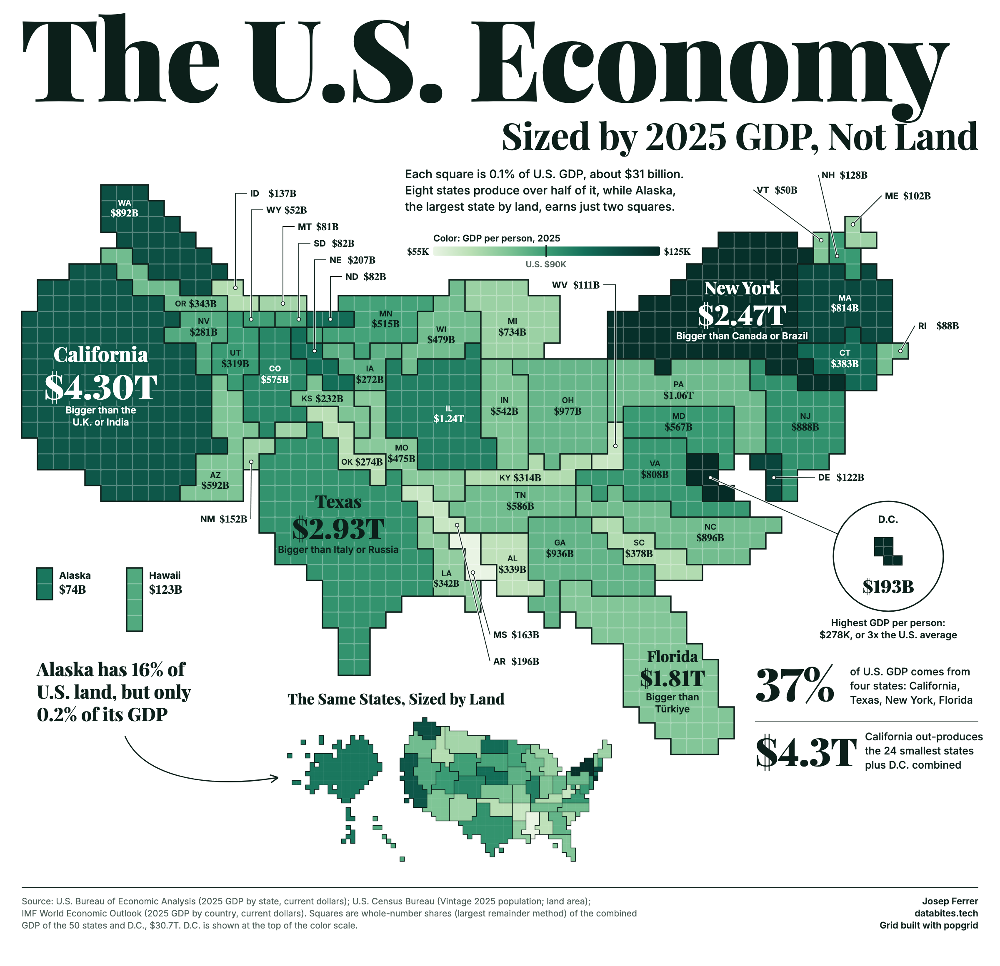

# The U.S. Economy, Sized by 2025 GDP, Not Land



A tiled map of the 50 states and D.C. with 1,000 squares, each one 0.1% of U.S. GDP (about $31 billion). Square count shows GDP, color shows GDP per person. A small land map of the same states sits alongside for contrast.

The squares come from [popgrid](https://github.com/databites-tech/popgrid), using official BEA figures instead of the modelled GDP bundled with the package.

## Run it

Needs Python and an installed Chrome, Chromium or Edge, which renders the PNG.

```bash
pip install -r requirements.txt
python make_map.py            # rebuilds output.png from the snapshot
python make_map.py --refresh  # downloads current figures first
```

The script checks every claim on the graphic against the data and stops if one no longer holds. Revised figures can trigger this after `--refresh`.

## Sources

- [U.S. Bureau of Economic Analysis](https://www.bea.gov/data/gdp/gdp-state): 2025 GDP by state, current dollars (table SAGDP2)
- [U.S. Census Bureau](https://www.census.gov/data/tables/time-series/demo/popest/2020s-state-total.html): Vintage 2025 state population
- [U.S. Census Bureau](https://www.census.gov/geographies/reference-files/2010/geo/state-area.html): state land area
- [IMF World Economic Outlook](https://www.imf.org/en/publications/weo): 2025 GDP by country, current dollars

Snapshots of the BEA, Census and IMF figures are in `data.csv` and `imf_2025.csv`.
